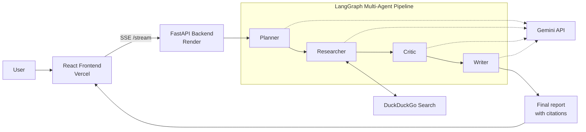

# 🧠 AI Research Team

A multi-agent research system: give it a topic, and a team of AI agents plans the research, searches the web, reviews the findings and writes a final report with citations, while you watch each agent work in real time.


## ✨ Features

- **4 specialized agents** orchestrated with LangGraph: Planner, Researcher, Critic, Writer
- **Live progress**: the frontend shows the status of each agent as it runs (Server-Sent Events)
- **Web search** with DuckDuckGo, no paid search API needed
- **Final report in Markdown** with cited sources
- **Fully deployed**: React frontend on Vercel, FastAPI backend on Render

---

## 🏗️ Architecture



### The agents

| Agent | Role |
|-------|------|
| **Planner** | Breaks the topic down into focused research questions |
| **Researcher** | Searches the web for each question and collects findings |
| **Critic** | Reviews the findings for gaps, weak sources and inconsistencies |
| **Writer** | Produces the final structured report with citations |

---

## 🛠️ Tech stack

| Layer | Technology |
|-------|------------|
| Agent orchestration | Python 3.11, LangGraph, LangChain |
| LLM | Google Gemini (`gemini-3.1-flash-lite`) via `langchain-google-genai` |
| Web search | `ddgs` (DuckDuckGo) |
| Backend | FastAPI, Server-Sent Events |
| Frontend | React (Vite), Markdown rendering |
| Deployment | Render (backend), Vercel (frontend) |

---

## 📁 Project structure

```
research-team/
├── backend/
│   ├── planner.py        # Planner agent
│   ├── researcher.py     # Researcher agent
│   ├── critic.py         # Critic agent
│   ├── writer.py         # Writer agent
│   ├── search_tool.py    # Web search tool (ddgs)
│   ├── graph.py          # LangGraph pipeline
│   ├── main.py           # FastAPI app (/research, /stream)
│   └── .env              # API keys (not committed)
└── frontend/
    └── src/
        └── App.jsx       # UI: agent status cards + final report
```

---

## 🚀 Run it locally

### Prerequisites

- Python 3.11+
- Node.js 18+
- A free Gemini API key from [Google AI Studio](https://aistudio.google.com/)

### 1. Clone the repo

```bash
git https://github.com/wajih1234/ai-research-team
cd ai-research-team
```

### 2. Backend

```bash
cd backend
python -m venv venv

# Windows (PowerShell)
venv\Scripts\Activate.ps1
# macOS / Linux
# source venv/bin/activate

pip install -r requirements.txt
```

Create a `backend/.env` file:

```
GOOGLE_API_KEY=your_gemini_api_key
```

Start the server:

```bash
uvicorn main:app --reload
```

The API is now running at http://localhost:8000. Interactive docs are at http://localhost:8000/docs.

### 3. Frontend

In a second terminal:

```bash
cd frontend
npm install
```

Create a `frontend/.env` file:

```
VITE_API_URL=http://localhost:8000
```

Start the dev server:

```bash
npm run dev
```

Open the URL shown in the terminal (usually http://localhost:5173).

---

## 🔌 API endpoints

| Method | Endpoint | Description |
|--------|----------|-------------|
| `POST` | `/research` | Runs the full pipeline and returns the final report |
| `GET` | `/stream` | Streams each agent's progress and the report via SSE |

---

## ☁️ Deployment

- **Backend (Render):** web service running the FastAPI app, with `GOOGLE_API_KEY` set as an environment variable
- **Frontend (Vercel):** React app with `VITE_API_URL` pointing to the Render backend URL

---


---

## 📄 License

Add a license of your choice (e.g. MIT).
